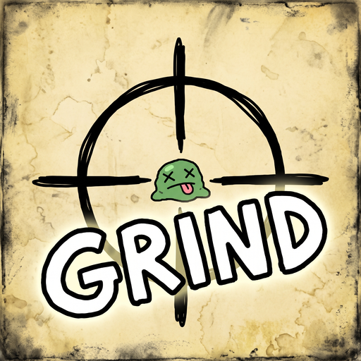

<p align="center"></p>

# MuckinatorGrind

A [BepInEx](https://github.com/BepInEx/BepInEx) mod for **Muck** that spawns mobs around you and fights them for you, so you can farm kills for the **Muckinator 1, 2, 3 and 4** achievements.

The mod reads your real kill count from Steam and always shows the **next Muckinator you have not unlocked yet**. A new player sees Muckinator 1, and someone close to the end sees Muckinator 4.

> **Version:** 1.0.0  
> **Author:** pramodexe  
> **Game:** Muck (Steam)  
> **Needs:** BepInEx 5

---

## Features

- **Muckinator tracker:** shows your live Steam kill count, your next Muckinator goal, a progress bar, your kills per minute and an estimated time to finish.
- **Mob spawner:** spawn Lil Dave, Goblin or Stone Golem in waves around you.
- **Quick presets:** Trickle, Standard, Horde, Swarm and Maximum, from slow and light to very fast and heavy.
- **Auto God Sword:** puts a God Sword in hotbar slot 1 and attacks with it.
- **Auto-aim:** turns your camera toward the nearest mob while attacking.
- **Auto-click:** holds down attack for you.
- **Unlimited health:** blocks all damage to you.
- **Unlimited stamina:** sprint forever.
- **Kill target:** stops by itself after a set number of kills.
- **Small HUD:** shows a status panel in the corner while the menu is closed.
- **Custom hotkeys:** change them in the menu.
- **Adjustable menu:** drag the bottom-right corner to resize it, and make it see-through in Settings.

### Menu tabs

| Tab | What's in it |
|-----|--------------|
| **Spawn** | Mob choice, presets, wave size, spawn radius, kill target, reset statistics |
| **Combat** | Unlimited health and stamina, God Sword, auto-aim, auto-click |
| **Settings** | Hotkeys, HUD, Muckinator tracker, interface scale, window opacity |

---

## Requirements

1. **Muck** on Steam.
2. **BepInEx 5** (the mod loader). Get it with **one** of these:
   - **Easy way:** [r2modman](https://thunderstore.io/package/ebkr/r2modman/) or the Thunderstore Mod Manager. Pick Muck, and it installs BepInEx for you.
   - **Manual way:** download *BepInExPack for Muck* from [Thunderstore](https://thunderstore.io/c/muck/), or BepInEx 5 (x64) from the [BepInEx releases page](https://github.com/BepInEx/BepInEx/releases).
3. **Optional:** [God Powers 2](https://thunderstore.io/c/muck/p/Crafterbot/God_Powers_2/) by Crafterbot. If it is installed, the mod uses its real God Sword model. If not, you still get a strong sword, but it looks like the normal sword.

---

## How to install

### Option A: from Thunderstore (easiest)

1. Open r2modman (or the Thunderstore Mod Manager) and choose **Muck**.
2. Go to **Online**, search for **MuckinatorGrind** and click **Download**.
3. BepInEx is installed for you automatically.
4. Click **Start modded**.

### Option B: manual install with r2modman

1. Open r2modman and choose **Muck**.
2. Select your profile. Make sure **BepInEx** is installed in it (it usually is by default).
3. Click **Settings → Browse profile folder**.
4. Open `BepInEx` → `plugins`.
5. Create a new folder named `MuckinatorGrind`.
6. Copy `MuckinatorGrind.dll` into that folder.
7. Start the game with **Start modded** in r2modman.

### Option C: manual install without a mod manager

1. Open your Muck game folder. In Steam: right-click **Muck → Manage → Browse local files**.
2. Install BepInEx there if you have not already. Unzip it so `BepInEx`, `winhttp.dll` and `doorstop_config.ini` sit right next to `Muck.exe`.
3. Start Muck once and then close it. This lets BepInEx create its folders.
4. Open `BepInEx` → `plugins`.
5. Copy `MuckinatorGrind.dll` into the `plugins` folder.
6. Start Muck normally.

**Linux / Steam Deck (Proton):** for a manual install, add this to Muck's Steam launch options so BepInEx loads:

```
WINEDLLOVERRIDES="winhttp=n,b" %command%
```

### Did it work?

When you are in a world, press **F2**. If the **MUCKINATOR GRIND** window opens, the mod is working.

If nothing happens, open `BepInEx/LogOutput.log` and search for `MuckinatorGrind`. You should see a line like `MuckinatorGrind 1.0.0 loaded.`

---

## How to use

1. Start or join a world. **You must be the host**, because only the host can spawn mobs. A solo game counts as host.
2. Press **F2** to open the menu.
3. In the **Spawn** tab, choose **Lil Dave**, **Goblin** (default) or **Stone Golem**, then pick a preset. **Standard** is a good place to start.
4. In the **Combat** tab, make sure **Auto God Sword**, **Auto-aim**, **Unlimited health** and **Unlimited stamina** are on.
5. Press **START** in the menu, or press **F8**.
6. Watch the **Muckinator** bar go up.

| Key | What it does |
|-----|--------------|
| **F2** | Open or close the menu |
| **F8** | Start / pause the farming session |
| **Esc** | Close the menu |

Both hotkeys can be changed in the **Settings** tab.

### Buttons

- **START** begins a new session and resets the session counters.
- **PAUSE** stops spawning and clicking. Mobs that are already alive stay, and your counters are kept.
- **STOP** ends the session.

---

## How the Muckinator tracker works

- Muck saves your total mob kills in a Steam stat called `Kills`. The mod reads this number a few times per second.
- Every 10 seconds the mod asks Steam which Muckinator achievements you have and reads each one's goal from its description (for example "Kill 10000 mobs").
- It always shows the **lowest Muckinator you have not unlocked yet**. When you unlock it, the display moves to the next one by itself.
- When all four are unlocked, it shows **MUCKINATOR — ALL DONE**.

Steam must be running and you must be logged in. If it is not, the tracker says **"Steam stats unavailable."**

> **Tip:** Muck only counts kills toward achievements in a normal game with Steam working. Kills from mobs this mod spawns count the same as any other kill.

---

## Settings

All settings save automatically. You can also change them in this file:

```
BepInEx/config/pramodexe.muckinatorgrind.cfg
```

| Setting | Default | What it does |
|---------|---------|--------------|
| `Mob` | Goblin | Which mob to spawn: Lil Dave, Goblin or Stone Golem |
| `BatchSize` | 25 | Mobs spawned per wave |
| `MaxActiveMobs` | 50 | Most mobs alive at the same time (limit 1000) |
| `SpawnInterval` | 5 | Seconds between waves |
| `SpawnRadius` | 12 | How far from you mobs appear |
| `UnlimitedHealth` | true | Block damage to you |
| `UnlimitedStamina` | true | Keep stamina full |
| `AutoGodSword` | true | Give and use the God Sword |
| `AutoAim` | true | Aim at the nearest mob |
| `AutoClick` | false | Auto-press left mouse button |
| `AutoClickInterval` | 0.15 | Seconds between clicks |
| `KillLimitEnabled` | false | Stop after a number of kills |
| `KillLimit` | 1000 | That number of kills |
| `StartPauseKey` | F8 | Start / pause hotkey |
| `MenuKey` | F2 | Menu hotkey |
| `ShowHud` | true | Show the small status panel |
| `MuckinatorTracker` | true | Show the Muckinator progress |
| `UiScale` | 1 | Make the menu bigger or smaller |
| `WindowOpacity` | 1 | Menu see-through amount, 0.3 to 1 |
| `WindowWidth` | 560 | Menu width (or drag the bottom-right corner) |
| `WindowContentHeight` | 340 | Menu height (or drag the bottom-right corner) |

---

## Tips and problems

- **Game is slow / laggy:** use a smaller preset (Trickle or Standard) or lower `MaxActiveMobs`. **Maximum** is very heavy.
- **"Start" button is grey:** you are not the host. Only the host can spawn mobs.
- **Tracker says Steam stats unavailable:** make sure Steam is open and you are online.
- **Menu opens but mobs don't appear:** load into a world first. The mob list comes from the game after a world loads.
- **The mod conflicts with another mod:** try removing other mob-spawner or combat mods to find which one.

---

## Build from source

You need the [.NET SDK](https://dotnet.microsoft.com/download) (6.0 or newer).

1. Clone this repo.
2. Copy `local.props.example` to `local.props` and set:
   - `MuckDir`: the folder with `Muck.exe`
   - `BepInExDir`: your BepInEx folder (the one that contains `core`)
3. Build:

   ```
   dotnet build -c Release
   ```

4. The mod will be at `bin/Release/netstandard2.0/MuckinatorGrind.dll`.

The game's own DLLs are **not** included in this repo. The build uses the ones from your own Muck install.

### Project files

```
MuckinatorGrind/
├── src/Plugin.cs              The whole mod
├── MuckinatorGrind.csproj     Build settings
├── local.props.example        Template for your own game paths
├── release/MuckinatorGrind.dll  Ready-to-use mod file
├── manifest.json              Mod info for Thunderstore / r2modman
├── CHANGELOG.md               What changed in each version
├── package.sh                 Builds the Thunderstore zip into dist/
├── icon.png                   Mod icon (256x256)
├── art/logo.png               Bigger logo for the README
└── README.md
```

### Thunderstore package

To make a zip you can upload to [Thunderstore](https://thunderstore.io/c/muck/), run:

```
./package.sh
```

It builds the mod and creates `dist/MuckinatorGrind-<version>.zip` with these files at the top level of the zip (no folders):

```
manifest.json
icon.png
README.md
CHANGELOG.md
MuckinatorGrind.dll
```

---

## Disclaimer

This is a fan-made mod. It is not made by or connected to Dani (the developer of Muck) or Valve. Using mods to unlock achievements is your choice; use it at your own risk.
